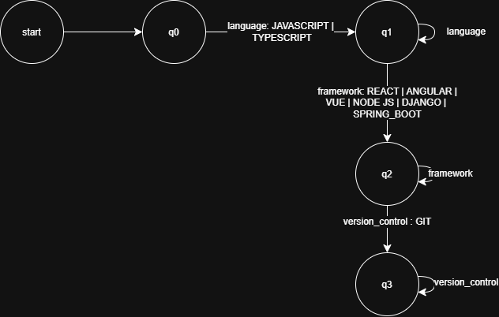
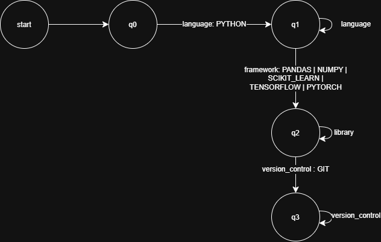
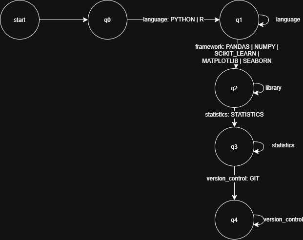
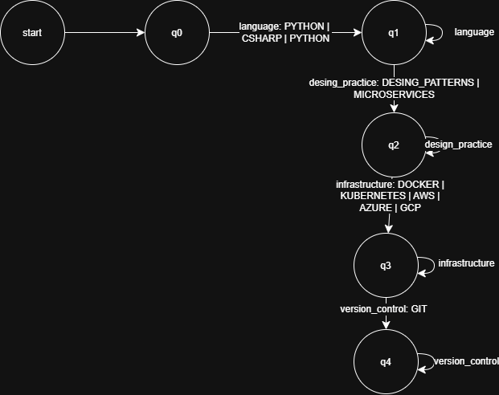

# Automata Formalization (Classification)
 
## Purpose
 
After normalization, a candidate is a list of canonical labels in the order of a profile. Stage 3 decides, for each of the four profiles, whether that list shows the skills the profile requires. Each profile has its own automaton, built in `classification/automata.py` from the groups declared in `classification/profile_patterns.py`.
 
## Formal definition (5-tuple)
 
For a profile with groups G₁, …, Gₙ (in this order), the automaton is
 
M = (Q, Σ, δ, q_0, F)
 
* Q = {q_0, q_1, …, q_n}: one state per group plus the start state. State qᵢ means "the groups G_1 to G_i have already been seen".

* Σ = G_1 ∪ G_2 ∪ … ∪ G_n: the labels of all the groups of the profile. Each label is one input symbol.

* δ: for every group Gᵢ and every `s ∈ Gᵢ`, `δ(qᵢ₋₁, s) = qᵢ` (move forward) and `δ(qᵢ, s) = qᵢ` (stay, a repeated skill of the same group). Any other pair is undefined.

* q₀: the initial state.

* F = {q_n}: the only final state.
The groups of one profile do not share labels, so δ is a function.

## Type of automaton

* Deterministic finite automaton (DFA): Is built with `pyformlang.finite_automaton.DeterministicFiniteAutomaton` (`is_deterministic()` returns true for the four automata).

* Partial: It has no explicit dead state. If there is no transition for a symbol, the input is rejected.

* No ε-transitions, one final state, and the only cycles are the self-loops that allow repeated skills of the same group.

## Language accepted

A word is accepted if and only if it has this shape: 

```
L(M) = G₁⁺ * G₂⁺ * … * Gₙ⁺
```

That is, one or more labels from G_1, then one or more from G_2, and so on up to G_n. For example, for the full-stack developer:

```
(JAVASCRIPT | TYPESCRIPT)⁺ (REACT | ANGULAR | VUE | NODE_JS | DJANGO | SPRING_BOOT)⁺ GIT⁺
```
 
In a few words: the candidate needs at least one skill from every group, listed in the order of the groups.

## How the input is prepared

`classify_qualifications(qualifications, profile_name)` does two things before running the automaton:
 
1. It keeps only the labels that are in the profile's alphabet Σ (so `SQL` or `REST_API` are ignored by the full-stack automaton).

2. It feeds the automaton with the list in the order it already has. That order comes from the canonical ordering of stage 2, which places the labels of each group one after the other in group order.

## The four automata
 
| Profile | Group | Labels |
|---------|-------|--------|
| `FULL_STACK_DEVELOPER` | language | `JAVASCRIPT`, `TYPESCRIPT` |
| | framework | `REACT`, `ANGULAR`, `VUE`, `NODE_JS`, `DJANGO`, `SPRING_BOOT` |
| | version_control | `GIT` |
| `MACHINE_LEARNING_ENGINEER` | language | `PYTHON` |
| | library | `PANDAS`, `NUMPY`, `SCIKIT_LEARN`, `TENSORFLOW`, `PYTORCH` |
| | version_control | `GIT` |
| `DATA_SCIENTIST` | language | `PYTHON`, `R` |
| | library | `PANDAS`, `NUMPY`, `SCIKIT_LEARN`, `MATPLOTLIB`, `SEABORN` |
| | statistics | `STATISTICS` |
| | version_control | `GIT` |
| `SOFTWARE_ARCHITECT` | language | `JAVA`, `CSHARP`, `PYTHON` |
| | design_practice | `DESIGN_PATTERNS`, `MICROSERVICES` |
| | infrastructure | `DOCKER`, `KUBERNETES`, `AWS`, `AZURE`, `GCP` |
| | version_control | `GIT` |
 
Size of each automaton:
 
| Profile | n | \|Q\| | \|Σ\| | Transitions | Final state |
|---------|---|-------|-------|-------------|-------------|
| `FULL_STACK_DEVELOPER` | 3 | 4 | 9 | 18 | q₃ |
| `MACHINE_LEARNING_ENGINEER` | 3 | 4 | 7 | 14 | q₃ |
| `DATA_SCIENTIST` | 4 | 5 | 9 | 18 | q₄ |
| `SOFTWARE_ARCHITECT` | 4 | 5 | 1

## State diagrams

Each arrow lists the labels of one group. The self-loop on a state carries the same labels as the arrow that enters it.

Full_stack_developer


 
Machine_learning_engineer



Data_scientist



Software_architect

