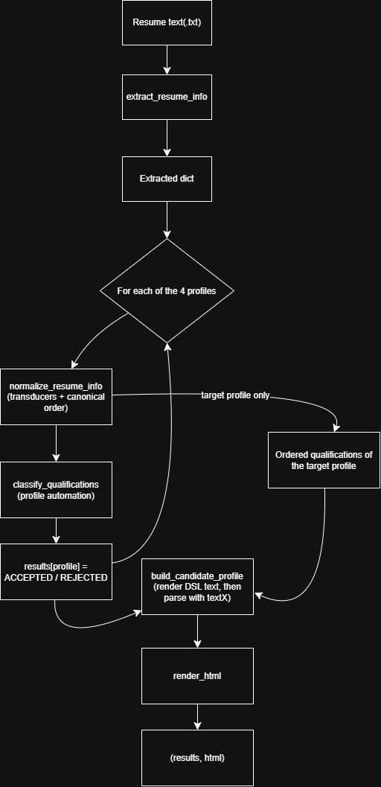

## Module Desing

ResumeLens is split into five modules inside src/resumelens/. Four of them are stage of a pipeline and the fifth `pipeline.py`, connects them. The only data that moves between stages is plain Python objects (a dict or a list), so each module can be tested alone

## Function Table

| Module | Function | Input | Output |
|--------|----------|-------|--------|
| `extraction` | `extract_resume_info(text)` | resume text (`str`) | `dict` with 9 keys: `name`, `contact`, `experience_years`, `programming_languages`, `frameworks`, `databases`, `tools`, `academic_qualifications`, `other_qualifications` |
| `extraction` | `extract_name`, `extract_contact_info`, `extract_experience_years`, `extract_programming_languages`, `extract_frameworks`, `extract_databases`, `extract_tools`, `extract_other_qualifications`, `extract_academic_qualifications` | resume text (`str`) | one field of the dict above |
| `extraction` | `save_extracted_info(info, output_path)` | `dict`, file path | JSON file |
| `normalization` | `normalize_token(token, transducer)` | token (`str`), FST | canonical label (`str`) or `None` |
| `normalization` | `normalize_category(tokens, category)` | `list[str]`, category key | `list[str]` of canonical labels |
| `normalization` | `normalize_qualifications(extracted_info)` | extracted `dict` | `list[str]` in fixed category order |
| `normalization` | `sort_qualifications(qualifications, profile_name)` | `list[str]`, profile name | `list[str]` in the profile's canonical order |
| `normalization` | `normalize_resume_info(extracted_info, profile_name)` | extracted `dict`, profile name | `dict` with `name`, `contact`, `experience_years`, `academic_qualifications` and the ordered `qualifications` |
| `classification` | `build_profile_automaton(groups)` | list of `(group_name, [symbols])` | `DeterministicFiniteAutomaton` |
| `classification` | `profile_alphabet(profile_name)` | profile name | `set[str]` of labels the profile uses |
| `classification` | `classify_qualifications(qualifications, profile_name)` | ordered `list[str]`, profile name | `"ACCEPTED"` or `"REJECTED"` |
| `profile_language` | `render_candidate_profile(name, contact, experience_years, qualifications, classification_results)` | candidate data | DSL text (`str`) |
| `profile_language` | `parse_candidate_profile(text)` | DSL text (`str`) | textX model (raises `TextXSyntaxError` if the text is invalid) |
| `profile_language` | `build_candidate_profile(...)` | same as `render_candidate_profile` | textX model (render + parse) |
| `profile_language` | `render_html(model)` | textX model | HTML page (`str`) |
| `pipeline` | `run_pipeline(resume_text, target_profile)` | resume text, target profile name | tuple `(results, html)`, where `results` maps each profile to its status |

## Flow diagram

## Design decisions
 
* One dictionary as the contract: Extraction returns one `dict` and every later stage reads from it, so the stages do not depend on each other's internals.

* Normalization runs once per profile: Each profile needs its own canonical order, so `run_pipeline` normalizes the same extracted data four times.

* The classifier filters before reading: `classify_qualifications` keeps only the labels that belong to the profile's alphabet, so skills the profile does not care about (for example `SQL` for a full-stack developer) do not break the automaton.

* The DSL validates the output: The pipeline first writes the candidate profile as DSL text and then parses it with textX. If the text does not follow the grammar, the parser raises an error instead of producing a wrong page.

* The HTML is built from the parsed model, not from the raw data: Only data that passed the grammar reaches the visualization.